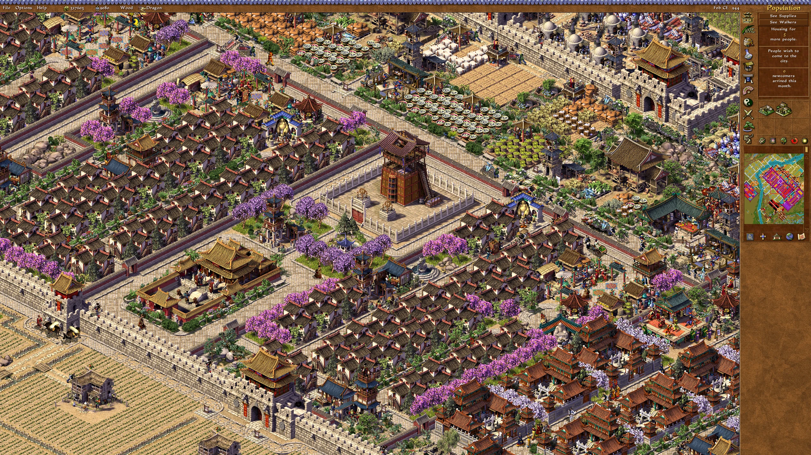
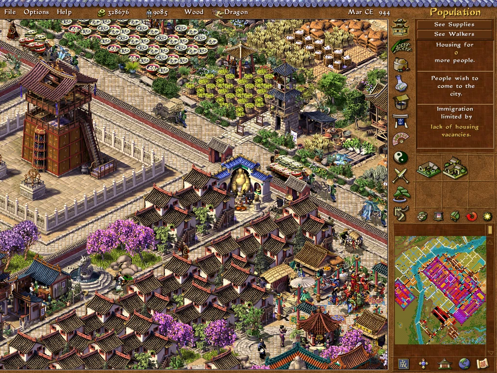

# Yongle

**Modern display and quality-of-life improvements for *Emperor: Rise of the Middle Kingdom* (2002).**

Yongle runs the original game at your monitor's resolution and refresh rate, lays its interface out for wide and high-resolution screens, scrolls the city smoothly and keeps the game speed steady in large cities. It is named after the Yongle Emperor of the Ming dynasty, who built the Forbidden City — in the tradition of [Julius](https://github.com/bvschaik/julius), [Augustus](https://github.com/Keriew/augustus) and [Akhenaten](https://github.com/dalerank/Akhenaten) for the other Impressions city builders.

> **Status: early (v0.1.3).** Tested on the GOG release of Emperor (version 1.0.1.0) on Windows 11. Expect rough edges; please report what you find (see [Reporting problems](#reporting-problems)).

*A city at 2560×1440 with Yongle, display scale 100 %. Click any screenshot for full size.*

For comparison: the original game at 1024×768

## Features and Roadmap

See **[docs/FEATURES.md](docs/FEATURES.md)** for details and screenshots of each feature.

See **[docs/ROADMAP.md](docs/ROADMAP.md)** for what is planned next and what comes later.

See **[CHANGELOG.md](CHANGELOG.md)** for what changed in each release.

- **No display mode changes:** a borderless full-screen window at your desktop resolution, scaled sharply.
- **Smooth frame rate** at your monitor's refresh rate; the game's own timing is unchanged.
- **Any resolution**, with the sidebar, top bar, city and dialogs laid out for your screen, and a display scale (100–250 % or *Auto*).
- **Menus, loading screens and the China map** at their own size in a frame, over a blurred picture of your city.
- **Windowed mode** (F5 or Alt+Enter), resizable, with its size and position remembered.
- **Pixel-smooth scrolling** of the city, at the game's own average speed.
- **Steady game speed** at every resolution, and a predictable 100 % speed.
- **Music and sounds pause** while you are switched away; ambient sounds at a steady rate.
- **Settings panel** (Insert) and Yongle's settings in the game's own Display options.
- **Screenshots** (F11) and **problem reports** (F12).

## How it works

Yongle is a single `ddraw.dll` in the game folder. It provides its own DirectDraw (Direct3D 11 or 9 through SDL3) and hooks the original `Emperor.exe` in memory; the game's files and your saves are never modified, and a feature that fails switches itself off and lets the game carry on as the original would. Delete `ddraw.dll` and the game is exactly as before. A full reimplementation that no longer needs `Emperor.exe` is a long-term goal.

**The original art stays as it is:** everything on screen is drawn from the game's own images. There are no plans for AI-generated or AI-upscaled backgrounds, artwork or other images.

## Requirements

- *Emperor: Rise of the Middle Kingdom*, version 1.0.1.0. Developed and tested with the **GOG release** (`Emperor.exe` SHA256 `6373328bfc5c4886d9abc9544eb706e89e7d465b18176ea8205fe27aaee53c0e`). On an unknown build the hooks do not install and the game runs as the original.
- Windows 10 or 11 and a graphics card with Direct3D 11.

## Installation

1. Download the latest release (`yongle-<version>.zip`) and unpack it. `ddraw.dll` is not code-signed, so antivirus or SmartScreen may warn about it; you can check the zip against the SHA256 on the release page.
2. Copy `ddraw.dll`, `ddraw.syms` and `emperor_engine.ini` into the game folder (the folder with `Emperor.exe`). If the folder already has a `ddraw.dll` from another tool (cnc-ddraw, dgVoodoo and so on), back it up first: only one can be used.
3. Start the game as usual.

**Uninstall:** delete `ddraw.dll`. Which other files Yongle creates, where they are when the game is under Program Files, skipping the intro movie and switching the renderer: see the **[FAQ](docs/FAQ.md)**.

## Keys

| Key             | Action                                                                                                |
| --------------- | ----------------------------------------------------------------------------------------------------- |
| Insert          | Open / close the settings panel (the game pauses while it is open)                                    |
| F5 or Alt+Enter | Switch between full screen and a window                                                               |
| F11             | Screenshot to `shots\`                                                                                |
| F12             | Problem report (when something looks wrong)                                                           |
| Shift+F7        | Cycle through a few resolutions until the game ends (for trying them out; the setting is not changed) |

## Settings

All settings are in `emperor_engine.ini` next to `ddraw.dll`; the file explains each one, and the panel (Insert) shows the same settings with descriptions. A missing file or setting means the default. The panel, screenshot and report keys can be changed there too.

## Known issues

Questions about Yongle's files, VirtualStore, the intro movie or the renderer? See the **[FAQ](docs/FAQ.md)** first.

The full list is in **[docs/KNOWN_ISSUES.md](docs/KNOWN_ISSUES.md)**. The main points:

- On laptops and slower computers, **lowering the resolution** (a higher display scale, or *Auto*) helps performance most.
- Game under `C:\Program Files (x86)` and **not run as administrator**: Yongle's files are in `%LOCALAPPDATA%\VirtualStore` (see the [FAQ](docs/FAQ.md)).
- Tested on AMD graphics and Intel integrated graphics so far; NVIDIA, real 4K monitors and several monitors not yet.

## Reporting problems

Please open an issue with the **Bug report** form. In short: delete `ddraw_proxy.log` in the game folder, reproduce the problem and press **F12** the moment you see it, then send the new `ddraw_proxy.log`, the `shots\report*` pictures and your `emperor_engine.ini`, with what you did, what you saw, your screen resolution, Windows version and graphics card.

## Building and Contributing

See **[docs/BUILDING.md](docs/BUILDING.md)** for the tools, the build steps, the offline tests and the code layout.

See **[CONTRIBUTING.md](CONTRIBUTING.md)** for how to propose changes and the rules contributions follow.

## Credits

- **[Augustus](https://github.com/Keriew/augustus)** (AGPL-3.0): its speed easing code (`core/speed.c`) is used for smooth scrolling (see `third_party/augustus/`), and its display scale, game speed and configuration designs were the models for ours.
- **[Julius](https://github.com/bvschaik/julius)**: studied for its rendering and timing.
- **[Akhenaten](https://github.com/dalerank/Akhenaten)**: its description of the `.sg3` image format was the reference for reading the game's own images.
- **[OpenRCT2](https://github.com/OpenRCT2/OpenRCT2)**: the approach of starting inside the original executable.
- **[zeus-qol](https://github.com/andrehamon/zeus-qol)**: studied for how its Zeus improvements are structured (no code used).
- Libraries: [SDL3](https://github.com/libsdl-org/SDL) (zlib), [Dear ImGui](https://github.com/ocornut/imgui) (MIT), [MinHook](https://github.com/TsudaKageyu/minhook) (BSD-2-Clause), miniz (public domain, the copy in SDL). Their licenses are in [THIRD_PARTY_NOTICES.md](THIRD_PARTY_NOTICES.md).
- *Emperor: Rise of the Middle Kingdom* was made by BreakAway Games and Impressions Games and published by Sierra.

## Disclaimer

Yongle is an unofficial fan project. It is not affiliated with or endorsed by the owners of *Emperor: Rise of the Middle Kingdom*. You need your own copy of the game; Yongle contains none of its files.

Developed with AI assistance; every stage is tested by a human in the game before release. Use it at your own risk and keep backups of your saves.

## License

Yongle is licensed under the **GNU Affero General Public License v3.0** — see [LICENSE](LICENSE). Third-party components keep their own licenses; see [THIRD_PARTY_NOTICES.md](THIRD_PARTY_NOTICES.md).
