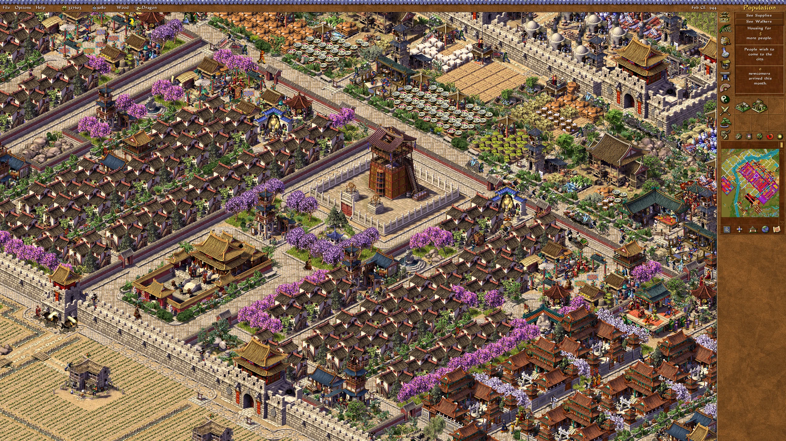
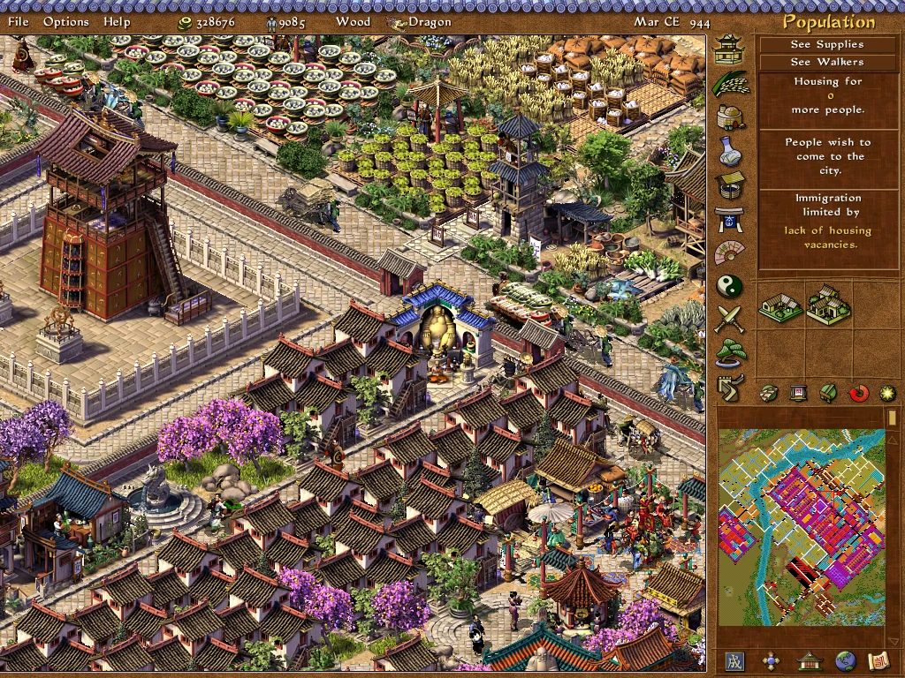
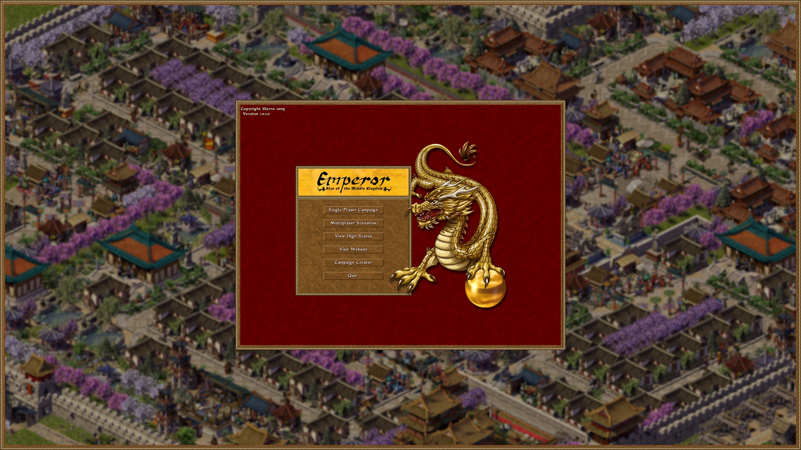
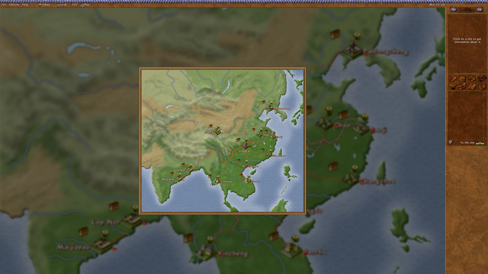
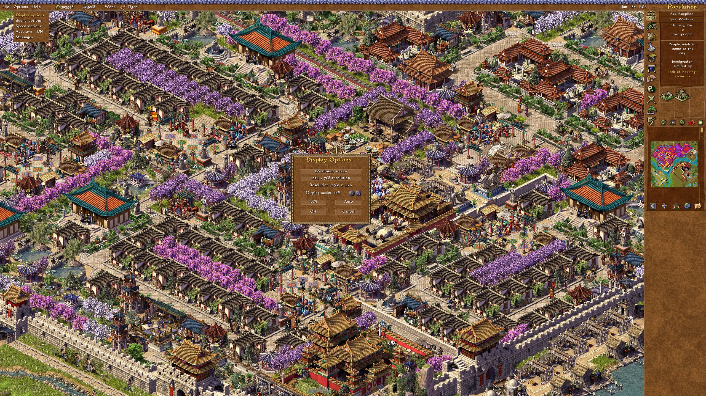
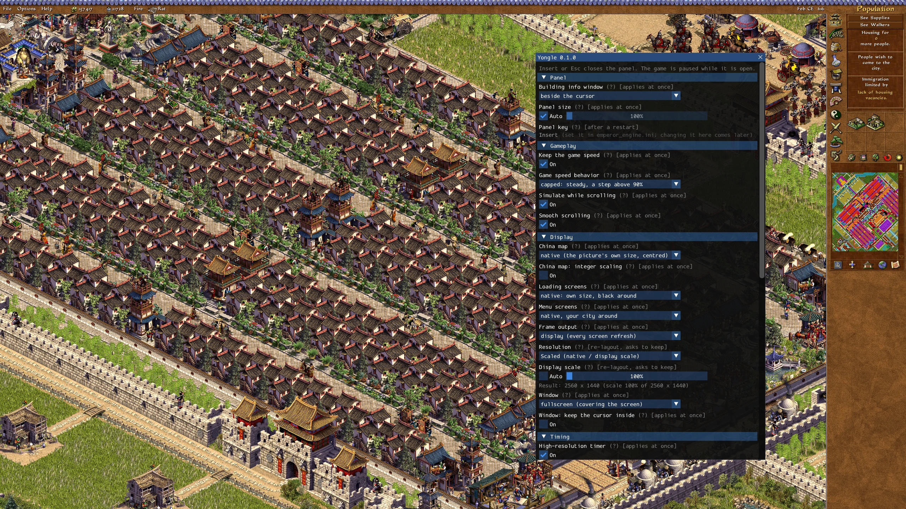

# Yongle

**Modern display and quality-of-life improvements for *Emperor: Rise of the Middle Kingdom* (2002), without touching the game's files.**

Yongle runs the original game at your monitor's resolution and refresh rate, lays its interface out for wide and high-resolution screens, scrolls the city smoothly and keeps the game speed steady in large cities. It is named after the Yongle Emperor of the Ming dynasty, who built the Forbidden City — in the tradition of [Julius](https://github.com/bvschaik/julius), [Augustus](https://github.com/Keriew/augustus) and [Akhenaten](https://github.com/dalerank/Akhenaten) for the other Impressions city builders.

> **Status: early (v0.1.0).** Tested on the GOG release of Emperor (version 1.0.1.0) on Windows 11. Expect rough edges; please report what you find (see [Reporting problems](#reporting-problems)).


*A city at 2560×1440 with Yongle, display scale 100 %. Click any screenshot for full size.*

<details>
<summary>For comparison: the original game at 1024×768</summary>


</details>

## How it works

Yongle is a single `ddraw.dll` placed in the game folder. Windows loads it instead of the system's DirectDraw, and from there it **hooks** the original `Emperor.exe` in memory: it provides its own DirectDraw implementation (drawn with SDL3 / Direct3D 11) and changes or replaces individual game functions while the game runs.

- **Your game stays clean.** `Emperor.exe`, the data files and your save games are never modified. Delete `ddraw.dll` and the game is exactly as before.
- Yongle's settings live in its own file, `emperor_engine.ini`. The game's own `Emperor.inf` only ever receives values the original game understands.
- Every hook first checks that the game's code is the expected version; if something does not match, or a feature fails at run time, that feature switches itself off, writes the reason to the log, and the game carries on as the original would.

This follows the [OpenRCT2](https://github.com/OpenRCT2/OpenRCT2) approach: start inside the original executable and replace its parts step by step, keeping the game playable at every step. A full **reimplementation** that no longer needs `Emperor.exe` (as Julius/Augustus did for Caesar III) is a **long-term goal**, not the current state.

**The original art stays as it is.** Yongle aims to preserve the game's own art style and atmosphere: everything on screen is drawn from the game's own images, at their own size or scaled sharply. There are no plans for AI-generated or AI-upscaled backgrounds, artwork or other images.

## Features

### Display
- **No more display mode changes.** The desktop resolution is never touched; the game is shown in a borderless full-screen window on your monitor, scaled sharply (nearest pixels with a one-pixel blend at their edges).
- **Smooth frame rate.** Frames follow your monitor's refresh rate instead of the original's ~20 per second. The game's own timing (simulation, animations) is unchanged.
- **Any resolution, laid out for your screen.** The game draws at your native resolution divided by a display scale (100–250 % in 5 % steps, or *Auto*: 1080 pixels high on taller screens, e.g. 1920×1080 on a 2560×1440 monitor). The sidebar and top bar extend to the screen's edges, the city fills the rest, and dialogs are centred.
- **Full-screen pictures** (main menu, loading screens) are shown at their own size in a frame instead of being stretched. Around the menus: a blurred, darkened picture of the last city you played — or your own picture (see [Your own menu background](#your-own-menu-background)).

  

- **China map** at its own size or enlarged, centred over a blurred backdrop of itself.

  

- **Windowed mode**: F5 or Alt+Enter. The window can be moved, resized and maximised; the game is laid out again for its new size, and its size and position are remembered. The cursor can optionally be kept inside the window.
- **In-game Display options** (Options → Display options): window mode, the game's own 1024×768, the display scale with the game's own arrow buttons, 100 %, Auto, OK / Cancel. Changes apply at once; OK saves them. This dialog will grow as more features arrive: display settings that are only in the settings panel today (resolution list, how the menus and the China map are shown, and so on) will move into it.

  
- Where a building's information window opens: original, centred, or next to the cursor (default).

### Gameplay feel
- **Pixel-smooth scrolling** of the city at the game's own average speed, with easing.
- **Steady game speed.** In the original, a large city at a high resolution runs slower, because the simulation waits for drawing. Yongle catches up on the missed simulation steps (as Augustus does), so every resolution runs at the speed you set.
- **Predictable 100 % speed.** The original's 100 % runs as fast as the computer can draw; by default Yongle caps it to a steady pace one step above 90 % (the original behaviour is a setting).
- **The city keeps running while you scroll** (the original pauses it; a setting).

### Tools
- **Settings panel** (Insert) for everything above, saved to `emperor_engine.ini`. Most settings apply immediately.

  

- **F11** saves a screenshot of the game's picture to `shots\`.
- **F12** writes a problem report (log mark, screenshots, statistics) for bug reports.
- An exception log with function names and source lines (`ddraw_proxy.log`, using `ddraw.syms`).
- The game's separate editor (`EmperorEdit.exe`, the Campaign Creator) runs unchanged.

## Requirements

- *Emperor: Rise of the Middle Kingdom*, version 1.0.1.0. Developed and tested with the **GOG release** (`Emperor.exe` SHA256 `6373328bfc5c4886d9abc9544eb706e89e7d465b18176ea8205fe27aaee53c0e`). Other copies of 1.0.1.0 may work; on an unknown build the hooks do not install and the game runs as the original.
- Windows 10 or 11 and a graphics card with Direct3D 11.

## Installation

1. Download the latest release (`yongle-<version>.zip`) and unpack it.
2. Copy `ddraw.dll`, `ddraw.syms` and `emperor_engine.ini` into the game folder (the folder with `Emperor.exe`).
3. Start the game as usual.

**Uninstall:** delete `ddraw.dll` (and, if you like, `ddraw.syms`, `emperor_engine.ini`, `ddraw_proxy.log`, `menu_background_auto.png` and the `shots\` folder). Nothing else was changed.

Files Yongle creates in the game folder: `ddraw_proxy.log` (log; it grows over sessions and can be deleted at any time), `emperor_engine.ini` (settings; a backup `emperor_engine.ini.bak` when old settings are cleaned up), `menu_background_auto.png` (the last city, for the menu backdrop) and `shots\` (F11 / F12).

## Your own menu background

By default the menus are shown over a blurred, darkened picture of the last city you played (saved as `menu_background_auto.png` when you leave a city). To use a picture of your own instead, put it in the game folder as **`menu_background.png`** (or **`menu_background.bmp`**). Any size works: it is scaled to cover the screen (cropped, not stretched), then blurred and darkened the same way. Delete it to go back to your last city. (Setting: `[display] menu_screens = native_city`, the default.)

## Keys

| Key | Action |
|---|---|
| Insert | Open / close the settings panel (the game pauses while it is open) |
| F5 or Alt+Enter | Switch between full screen and a window |
| F11 | Screenshot to `shots\` |
| F12 | Problem report (when something looks wrong) |
| Shift+F7 | Cycle through a few resolutions until the game ends (for trying them out; the setting is not changed) |

The panel, screenshot and report keys can be changed in `emperor_engine.ini`.

## Settings

All settings are in `emperor_engine.ini` next to `ddraw.dll`; the file explains each one, and the panel (Insert) shows the same settings with descriptions. A missing file or setting means the default. The defaults: full screen at your native resolution (display scale 100 %), smooth scrolling on, steady game speed on, 100 % speed capped, the city running while scrolling.

## Known issues

- **Flashing black blocks** have been seen occasionally after playing for a while on one system (AMD graphics); screenshots do not show them, and switching windows (Alt+Tab) clears them. The cause is not known yet. If you see them, press F12 and send the log and `shots\` folder.
- The map and campaign editors and the multiplayer screens run at 1024×768 (centred), not at your resolution.
- The campaign map screen has not been tested in play yet.
- Tested on one machine so far (AMD graphics, 2560×1440; 1920×1080 by changing the Windows resolution). **Real 4K monitors and NVIDIA / Intel graphics have not been tested yet** — reports are welcome.
- An original-game crash remains: in heavily modified saves with many monuments, opening the Monuments panel can crash the game (this happens without Yongle too).
- Small cosmetic quirks of the original are kept for now (e.g. text sitting slightly high in some dialog buttons).

## Roadmap

Near term:
- **City zoom** (mouse wheel, centred on the cursor), then **export of the whole city as one large image**.
- **Original-style settings screens**: the settings drawn with the game's own art, grouped into the game's option dialogs (all display settings in Display options, and so on).
- **Key rebinding** in a game-style dialog.

Longer term:
- **Localisation**: UTF-8 translation files and a text engine with open-source fonts, starting with Traditional Chinese. The format will be open and documented, so the community can add **language packs** for other languages without changing the game's files.
- Raising the original's limits and fixing its bugs; better support for custom scenarios.
- Smoother movement of people and animations between simulation steps.
- **Zeus & Poseidon** support with the same engine.
- Eventually, a **reimplementation** that no longer needs the original executable.

## Building from source

Yongle is C++20 (with a small C entry point), built as a 32-bit DLL with [llvm-mingw](https://github.com/mstorsjo/llvm-mingw).

Tools (the versions used; paths are parameters of the scripts):
- llvm-mingw `20261006` (ucrt, x86_64 host)
- CMake 4.4.4
- Python 3 (for the symbol table `ddraw.syms`)
- SDL3 3.4.18 source release

Steps (PowerShell, in the repository folder):

```powershell
# 1. Build SDL3 once (static, 32-bit) into build\sdl3-i686-install
powershell -File tools\build_sdl3.ps1 -Source <SDL3-3.4.18 folder> -Toolchain <llvm-mingw folder> -CMake <cmake.exe>
# 2. Build the DLL (build\engine\ddraw.dll, ddraw.syms) and the offline tests
powershell -File proxy\ddraw\build.ps1 -Toolchain <llvm-mingw folder> -CMake <cmake.exe>
# 3. Run the offline tests (they do not need the game)
powershell -File proxy\ddraw\run_tests.ps1
```

Layout: `proxy/` is the DLL's entry point; `src/core/` is the game-independent engine (hooks, DirectDraw emulation and output, settings, panel, diagnostics); `src/games/emperor/` holds everything specific to Emperor (addresses, hooks). The core contains no game addresses, so other games can be added later. Vendored libraries are in `third_party/`.

The design notes and reverse-engineering records are kept in Traditional Chinese for now and are not published yet; they will follow once translated. Comments in the code refer to them (`docs/...`).

## Reporting problems

Please open an issue with the **Bug report** form (it walks you through the same steps we use in our own tests). In short:
- close the game and delete `ddraw_proxy.log` in the game folder (it keeps growing over sessions);
- reproduce the problem and press **F12** the moment you see it (it saves screenshots to `shots\` and marks the log);
- send the new `ddraw_proxy.log`, the `shots\report*` pictures and, if you changed settings, `emperor_engine.ini`;
- say what you did and what you saw, and give your screen resolution, Windows version and graphics card.

## Contributing

Contributions are welcome. For anything beyond a small fix, please open an issue first to discuss it.

- Keep the two layers apart: nothing game-specific (addresses, structures) in `src/core/`.
- Every hook must check the game's bytes before installing and fall back to the original behaviour on failure.
- Never add files from the game (art, text, data) or derived from them to the repository.
- No AI-generated or AI-upscaled images (backgrounds, artwork, interface graphics): the project keeps the original art style, so such contributions will not be accepted.
- Run the offline tests before submitting.
- By contributing you agree that your contribution is licensed under the AGPL-3.0.

## Credits

**Contributors**

- **[riap0526](https://github.com/riap0526)**: creator and maintainer; direction, design decisions and all in-game testing.
- **Claude** (Anthropic): AI assistant for reverse engineering, code and documentation, under the maintainer's direction (see [Disclaimer](#disclaimer)).

**Projects and libraries**

- **[Augustus](https://github.com/Keriew/augustus)** (AGPL-3.0): its speed easing code (`core/speed.c`) is used for smooth scrolling (see `third_party/augustus/`), and its display scale, game speed and configuration designs were the models for ours.
- **[Julius](https://github.com/bvschaik/julius)**: studied for its rendering and timing.
- **[Akhenaten](https://github.com/dalerank/Akhenaten)**: its description of the `.sg3` image format was the reference for reading the game's own images.
- **[OpenRCT2](https://github.com/OpenRCT2/OpenRCT2)**: the approach of starting inside the original executable.
- **[zeus-qol](https://github.com/andrehamon/zeus-qol)**: studied for how its Zeus improvements are structured (no code used).
- Libraries: [SDL3](https://github.com/libsdl-org/SDL) (zlib), [Dear ImGui](https://github.com/ocornut/imgui) (MIT), [MinHook](https://github.com/TsudaKageyu/minhook) (BSD-2-Clause). Their licenses are in [THIRD_PARTY_NOTICES.md](THIRD_PARTY_NOTICES.md).
- *Emperor: Rise of the Middle Kingdom* was made by BreakAway Games and Impressions Games and published by Sierra.

## Disclaimer

Yongle is an unofficial fan project. It is not affiliated with or endorsed by the owners of *Emperor: Rise of the Middle Kingdom*. You need your own copy of the game; Yongle contains none of its files.

**This project is developed with AI assistance** (Anthropic's Claude writes much of the code and analysis). Every stage is tested by a human in the actual game before it is accepted, with a check that the original game still starts and loads its saves without the DLL. Still, use it at your own risk and keep backups of your saves.

## License

Yongle is licensed under the **GNU Affero General Public License v3.0** — see [LICENSE](LICENSE). Third-party components keep their own licenses; see [THIRD_PARTY_NOTICES.md](THIRD_PARTY_NOTICES.md).
