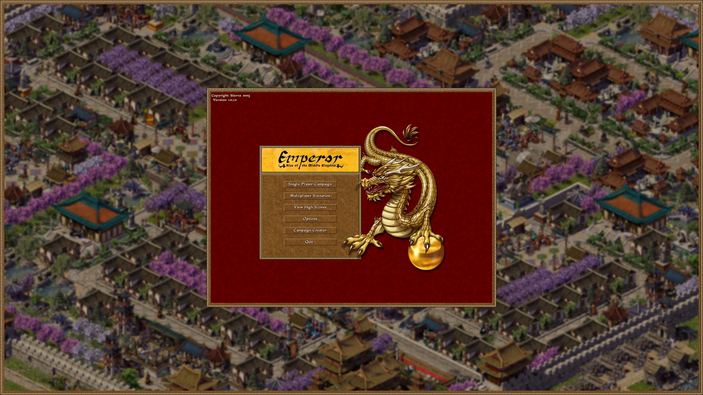
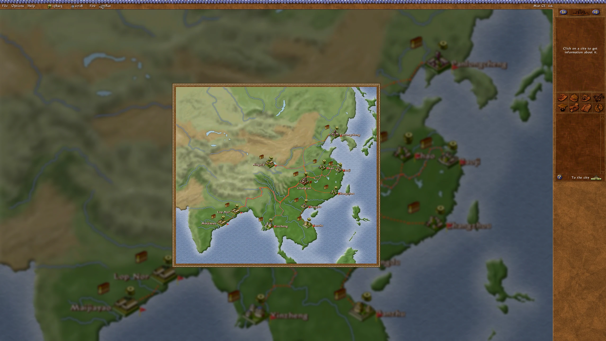
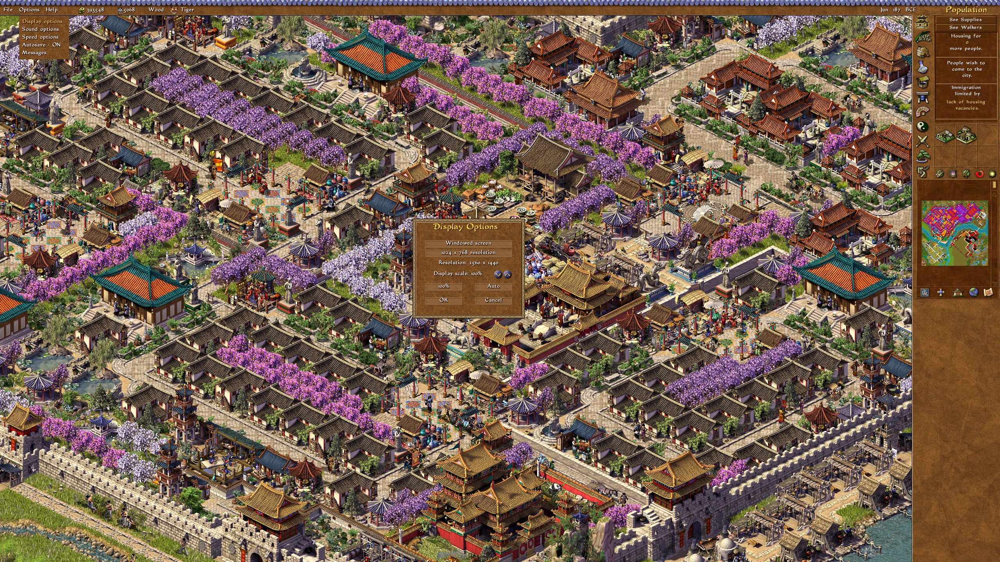
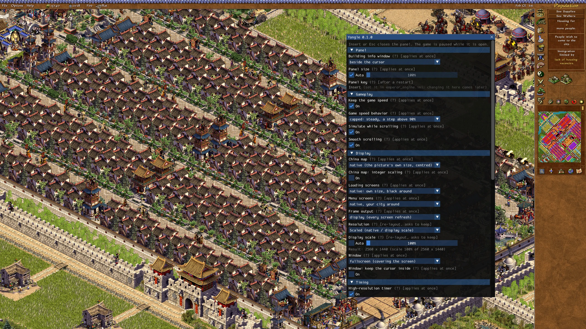

# Features

Back to the [README](../README.md). All settings are in `emperor_engine.ini` and in the settings panel (Insert); see [Settings](../README.md#settings).

## Display

- **No more display mode changes.** The desktop resolution is never touched; the game is shown in a borderless full-screen window on your monitor, scaled sharply (nearest pixels with a one-pixel blend at their edges). Plain nearest pixels or smooth scaling are also available (Display options or `scaling`).

- **Smooth frame rate.** Frames follow your monitor's refresh rate instead of the original's ~20 per second. The game's own timing (simulation, animations) is unchanged.

- **Any resolution, laid out for your screen.** The game draws at your native resolution divided by a display scale (100–250 % in 5 % steps, or *Auto*: 1080 pixels high on taller screens, e.g. 1920×1080 on a 2560×1440 monitor). The sidebar and top bar extend to the screen's edges, the city fills the rest, and dialogs are centered.

- **Full-screen pictures** (main menu, loading screens) are shown at their own size in a frame instead of being stretched. Around the menus: a blurred, darkened picture of the last city you played — or your own picture (see [MENU_BACKGROUND.md](MENU_BACKGROUND.md)).

  

- **China map** at its own size or enlarged (to fit, or by a percentage), centered over a blurred backdrop of itself, or over your city as you left it.

  

- **Windowed mode**: F5 or Alt+Enter. The window can be moved, resized and maximized; the game is laid out again for its new size, and its size and position are remembered. The cursor can optionally be kept inside the window.

- **In-game Display options** (Options → Display options): window mode, the game's own 1024×768, the display scale, 100 %, Auto, output scaling. Changes apply at once; OK saves them. More display settings will move here from the settings panel.

  

- Where a building's information window opens: original, centered, or next to the cursor (default).

## Gameplay feel

- **Pixel-smooth scrolling** of the city at the game's own average speed, with easing.
- **Steady game speed.** In the original, a large city at a high resolution runs slower, because the simulation waits for drawing. Yongle catches up on the missed simulation steps (as Augustus does), so every resolution runs at the speed you set.
- **Predictable 100 % speed.** The original's 100 % runs as fast as the computer can draw; by default Yongle caps it to a steady pace one step above 90 % (the original behavior is a setting).
- **The city keeps running while you scroll** (the original pauses it; a setting).

## Sound

- **Music and sounds pause when you switch away** (Alt+Tab, another window, minimizing) and go on where they were when you come back (the original stops them and starts another song; a setting).
- **Ambient sounds at a steady rate**, about one every two seconds whatever the resolution and computer (the original's rate depends on how fast its main loop runs; a setting).

## Tools

- **Settings panel** (Insert) for everything above, saved to `emperor_engine.ini`. Most settings apply immediately.

  

- **F11** saves a screenshot of the game's picture to `shots\`.

- **F12** writes a problem report (log mark, screenshots, statistics) for bug reports.

- An exception log with function names and source lines (`ddraw_proxy.log`, using `ddraw.syms`).

- The game's separate editor (`EmperorEdit.exe`, the Campaign Creator) runs unchanged.
