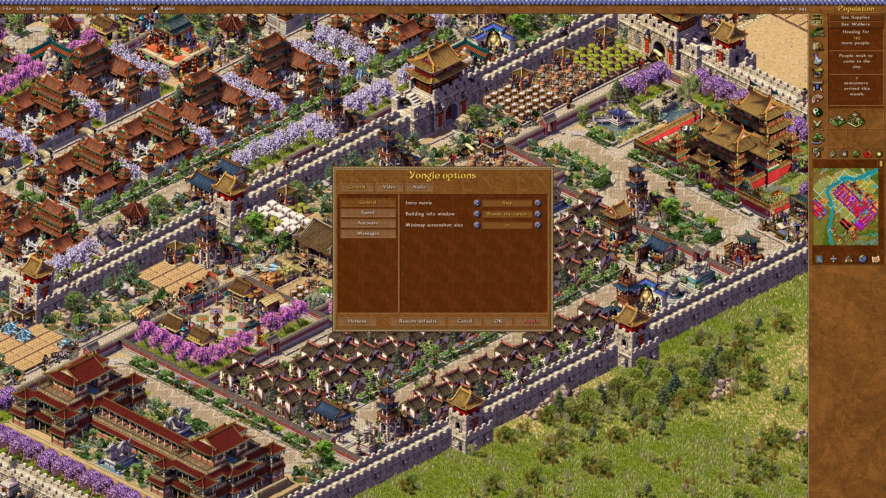
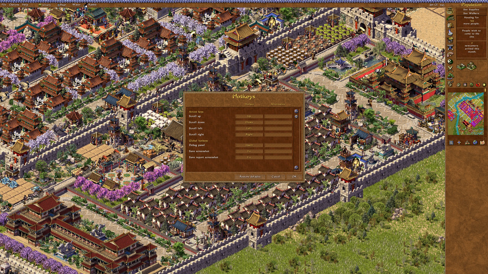
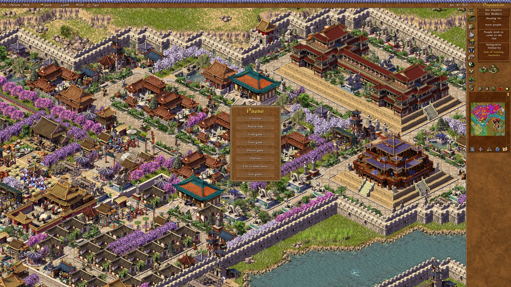
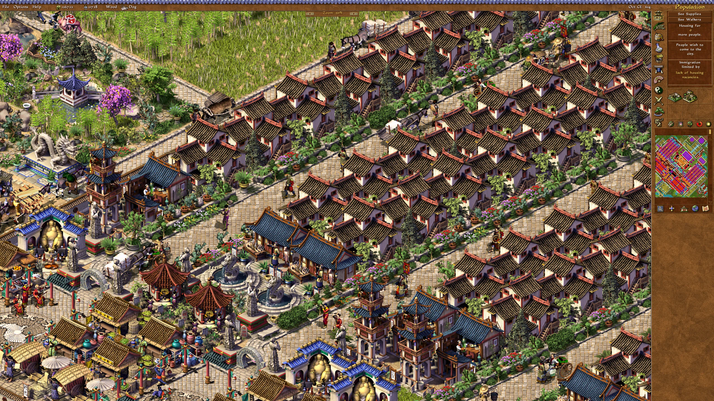
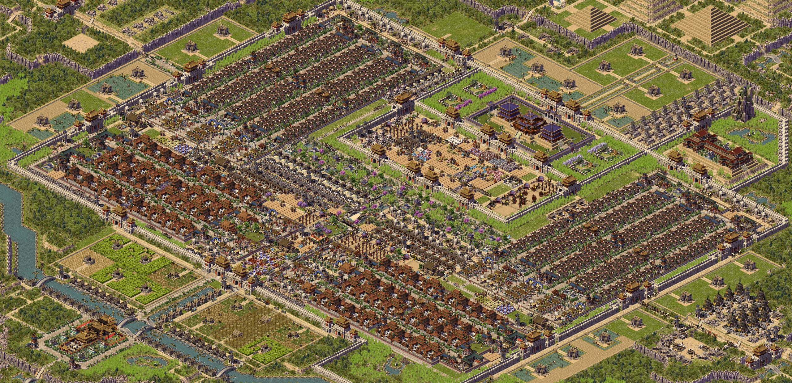
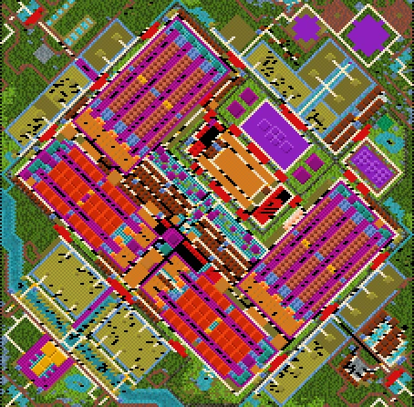

# Features

Back to the [README](../README.md). Most settings are in the Options window (F6, the Options menu in the city, or the main menu). All of them are also in `emperor_engine.ini`. See [Settings](../README.md#settings).

## Display

- **No display mode changes.** Your desktop resolution stays as it is. The game runs in a borderless full-screen window and is scaled up sharply (nearest pixels, with a one-pixel blend at the edges). You can also pick plain nearest pixels or smooth scaling (Options > Video > Scaling).

- **Smooth frame rate.** The picture updates at your monitor's refresh rate instead of the original's ~20 frames a second. The game's own timing (simulation, animations) doesn't change.

- **Any resolution.** The game runs at your screen's resolution divided by the display scale (100–250 % in 5 % steps, or *Auto*, which makes it 1080 pixels high on bigger screens, e.g. 1920×1080 on a 2560×1440 monitor). The sidebar and top bar reach the edges of the screen, the city fills the rest, and dialogs are centered.

- **Every screen uses the display scale.** Menus, briefings and loading screens get bigger along with the city. They are shown in a frame instead of stretched, and only made smaller if they don't fit. Around the menus you can have a blurred, darkened picture of the last city you played (or a picture of your own, see [MENU_BACKGROUND.md](MENU_BACKGROUND.md)), parchment, or black like the original (*Menu screens*).

  

- **Empire map** at its normal size or bigger (to fit the screen, or by a percentage), centered over a blurred copy of itself or over your city.

  

- **Windowed mode**: F5 or Alt+Enter. You can move, resize and maximize the window, and the game adjusts to the new size. The window's size and position are remembered. You can also keep the mouse cursor inside the window.

- **Information window position.** You can choose where a building's information window opens: as in the original, in the center, or next to the cursor (default).

## Options and keys

- **Options window.** A settings window that looks like the game's own dialogs, made from the game's panels, buttons and font. It has the game's settings (game speed, scroll speed, autosave, messages, music, speech and sound volumes) and Yongle's settings together, on General, Video and Audio pages. Open it with **F6**, from the Options menu in the city (General Settings, Video, Audio, Hotkeys), or from **Options** on the main menu. Hover over a setting to see what it does. *Restore defaults* resets only the section you are looking at. If you change the resolution or display scale, the game asks "Keep this setting?" and switches back after 15 seconds if you don't answer. The game's own settings are still saved in the game's files, so they are the same without Yongle.

  

- **Key rebinding** (Options > Hotkeys). You can change almost every key in the game (scrolling, rotating, speed, pause, building categories, overlays, bookmarks, army companies) and Yongle's own keys, with a main and an alternative key for each action. Click a key, then press the new one (Ctrl, Shift and Alt combinations work). Right-click a key to clear it. The mouse side buttons can be used too. If a key is already used, or the game needs it for itself, the window tells you instead of taking it. The default keys are the same as the original game, and the "Game paused" message shows your pause key.

  

- **Esc closes windows**, like a right click, including confirmation boxes. In the city, Esc cancels the building tool or the selected company first; otherwise it opens the **Pause menu** (Continue, Replay map, Load game, Save game, Delete game, Options, Exit to main menu, Exit game). The game is paused while the menu is open. On the menu screens, Esc goes back like a right click, and on the main menu it asks before quitting.

  

- **The File menu** has the same items, plus the two city screenshots: Replay map, Load game, Save game, Save city screenshot, Save minimap screenshot, Delete game, Exit to main menu, Exit game.

- **New players start at 80 % game speed and 30 % scroll speed** (the original defaults are 90 % and 60 %), which work better with smooth scrolling. If you have played before, your settings stay the same.

- **Intro movie**: play it (default) or skip it (Options > General Settings). The game's own files are not changed.

## Gameplay feel

- **Smooth scrolling.** The city scrolls pixel by pixel, at the same average speed as the original, and eases in and out.
- **City zoom.** Turn the mouse wheel over the city to zoom out and see more, or zoom in to see it bigger, in steps of 25 % from 50 % to 150 % (less on small maps, so the view stays inside the map). A "Zoom" message at the top shows the current level. The spot under the cursor stays in place, and the zoom is animated when smooth scrolling is on. The middle mouse button goes back to 100 %. Over the sidebar, the wheel still changes the building category. Clicking, building, selecting and sounds all work at any zoom, and the sidebar and menus keep their size. You can set the zoom the game starts with (*Starting city zoom* in Options > Video); zooming with the wheel is not saved, and saved games are not affected. Zooming out is slower, because the game has more of the city to draw.

  

- **Steady game speed.** In the original, a big city at a high resolution runs slower, because the simulation waits for the drawing. Yongle catches up on the missed simulation steps (like Augustus), so the game runs at the speed you set at any resolution. Time spent in a window or the Pause menu is not caught up, so the city doesn't jump when you close it.
- **Predictable 100 % speed.** In the original, 100 % runs as fast as your computer can draw. By default Yongle limits it to a steady speed, one step above 90 % (you can switch back to the original).
- **The city keeps running while you scroll** (the original pauses it; you can switch this back).

## Sound

- **Master volume and mute** for all music and sounds (Options > Audio). The game's own volume settings are kept.
- **Music and sounds pause when you switch away** (Alt+Tab, clicking another window, minimizing) and continue where they left off when you come back. The original stops them and starts a different song (you can switch back to that).
- **Ambient sounds at a steady rate**, about one every two seconds on any computer and at any resolution. In the original, the rate depends on how fast the game runs (you can switch back to that).
- **Unused nature sounds.** The game comes with recordings of birds, wind, crickets, frogs and wind chimes that it never actually played. Yongle plays one of them now and then in the city, about every 30 seconds, moving slowly around you, at the sound effects volume. On by default; you can turn it off in Options > Audio.

## Screenshots and tools

- **Full city screenshot** (F10, or File > Save city screenshot). Saves the whole city, as far as you can scroll, as one PNG at the game's normal size, without the interface, whatever the zoom. A big city gives a picture of about 9000×4500 pixels. The game pauses for a moment while the city is drawn, and the file is saved in the background while you keep playing.

  

- **Minimap screenshot** (Shift+F10, or File > Save minimap screenshot), twice the size of the minimap by default.

  

- **F11** saves a screenshot of the game to `shots\`. Messages like "screenshot saved" or the zoom level appear in the game's own message boxes.

- **F12** writes a problem report (a mark in the log, screenshots, statistics, recent display changes) to attach to bug reports.

- **Debug panel** (Insert): settings for testing and for fixing the display if something goes wrong, plus the folder where Yongle keeps its files. "Show all settings" lists everything else.

- **Error details in the log.** If something goes wrong, the log (`ddraw_proxy.log`) shows where, with function names and source lines (from `ddraw.syms`).

- **The Campaign Creator** (`EmperorEdit.exe`, the game's separate editor) works as before.
