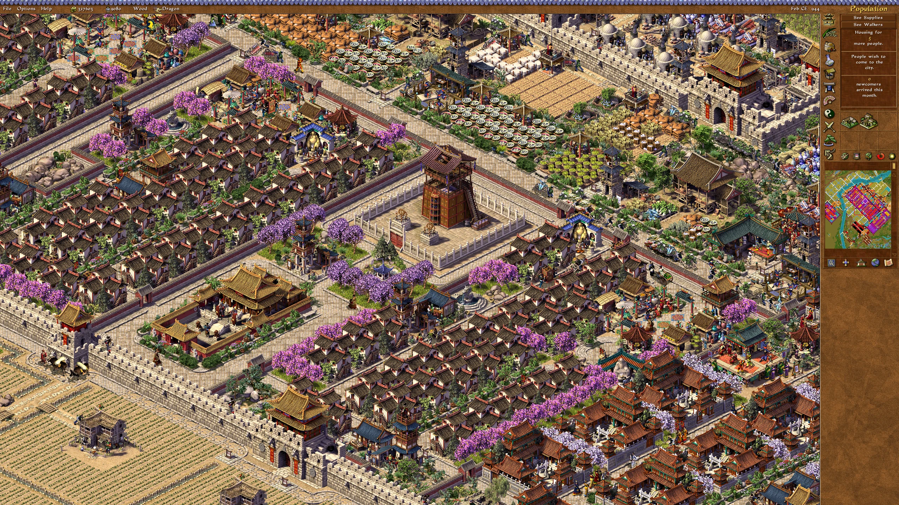
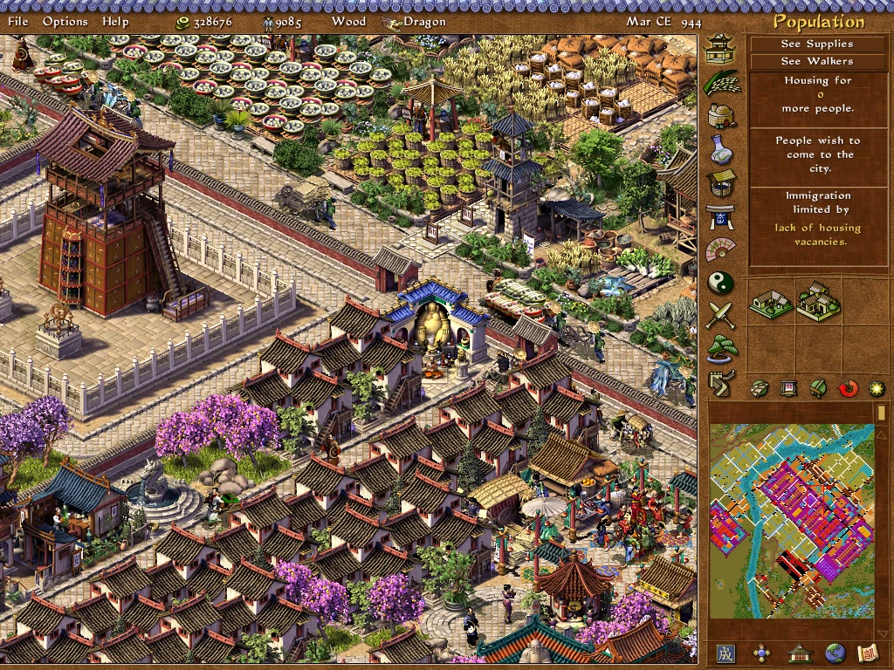

[English](../README.md) | [繁體中文](README.zh-TW.md) | **简体中文**

> 这是英文版 README 的翻译，内容以[英文版](../README.md)为准。对应的英文版：Yongle 0.2.1。
>
> Yongle 目前不支持任何中文版的 *Emperor: Rise of the Middle Kingdom*，只能配合英文版使用。我们正在规划自己重新翻译的汉化，目前还没有确定的发布时间。

# Yongle

**为 *Emperor: Rise of the Middle Kingdom*（2002）加上现代的画面显示与便利性改进。**

| 平台            | 最新版本                                                                                                                                               |
| --------------- | ------------------------------------------------------------------------------------------------------------------------------------------------------ |
| Windows 10 / 11 |  |

在发布页面下载 **`yongle-<version>.zip`**，不是“Source code (zip)”：源代码里没有 `ddraw.dll`。然后看[安装](#安装)。

Yongle 保留原版游戏，让它适合现在的电脑：游戏以你的屏幕分辨率运行，界面也按屏幕重新排列，另外加上一些便利性改进，在一个和游戏风格相同的 Options 窗口里设置。之后还会加入更多功能，包括游戏玩法的选项。名字来自明朝修建紫禁城的永乐皇帝，延续了 [Julius](https://github.com/bvschaik/julius)、[Augustus](https://github.com/Keriew/augustus) 和 [Akhenaten](https://github.com/dalerank/Akhenaten) 为其他 Impressions 城市建造游戏取名的传统。

如果你也玩 *Zeus + Poseidon*，你可能也会喜欢姊妹项目 [Pericles](https://github.com/riap0526/pericles)：它和 Yongle 用同一套引擎、同样的设计理念。

*使用 Yongle 的 2560×1440 城市画面，显示缩放 100 %。点击任何一张截图可以查看原尺寸。*

对照：原版游戏的 1024×768

## 功能与 Roadmap

每项功能的说明与截图见 **[docs/FEATURES.md](../docs/FEATURES.md)** (English)。

接下来的 Roadmap 与之后要做的事见 **[docs/ROADMAP.md](../docs/ROADMAP.md)** (English)。

每个版本改了什么见 **[CHANGELOG.md](../CHANGELOG.md)** (English)。

- **不切换显示模式：** 游戏在无边框的全屏窗口里以桌面分辨率运行，锐利地放大。
- **流畅的画面**：以显示器的刷新率显示。游戏本身的计时不变。
- **任何分辨率：** 侧栏、顶栏、城市和对话框都适应你的屏幕，显示缩放（100–250 % 或 *Auto*）可以让每个画面都变大。
- **菜单、加载画面和帝国地图**显示在一个框里，背景是你的城市的模糊画面。
- **窗口模式**（F5 或 Alt+Enter）。窗口可以调整大小，大小和位置会被记住。
- **平滑滚动**城市画面，每一档滚动速度设置都有稳定的速度。
- **城市缩放**：用鼠标滚轮（50–150 %，地图比较小时范围也比较小），以光标为中心。按鼠标中键回到 100 %。
- **拖动滚动**：按住鼠标中键移动。
- **Options 窗口**（F6）：游戏的设置和 Yongle 的设置放在一起。
- **重新绑定按键**：几乎每个按键都可以改，每个动作可以设两个按键。
- **Esc 关闭窗口**，在城市里打开**暂停菜单**。
- **Difficulty 和 Auto defend** 放进 Options：游戏本来就有这两项，但从来不让你改。
- **稳定的游戏速度：** 原版在大城市、高分辨率时会比你设置的速度慢，现在任何分辨率都按你设置的速度运行；100 % 也改成固定的速度（比 90 % 快一档），不再是电脑画得多快就跑多快。
- **声音：** 主音量；切换到其他窗口时，音乐和音效会暂停；环境音以稳定的频率播放；还有游戏里没有用到的自然音效。
- **截图**（F11）、**整个城市和小地图的截图**（F10、Shift+F10），以及**问题报告**（F12）。

## 工作原理

Yongle 只是游戏文件夹里的一个 `ddraw.dll`。它用自己的 DirectDraw 取代游戏原本用的（通过 SDL3 使用 Direct3D 11 或 9），而且只在内存里修改原版的 `Emperor.exe`。游戏的文件和你的存档都不会被修改。Yongle 的某个功能遇到错误时，会自行关闭，游戏按原版的方式继续运行。删除 `ddraw.dll`，游戏就和以前完全一样。长期目标是完整地重新实现，不再需要 `Emperor.exe`。

**原版的美术保持原样：** 画面上的一切都是用游戏自己的图像绘制的。没有计划使用 AI 生成或 AI 放大的背景、美术或其他图像。

## 系统要求

- **英文版**的 *Emperor: Rise of the Middle Kingdom*，版本 1.0.1.0。开发和测试用的是 **GOG 版**（`Emperor.exe` SHA256 `6373328bfc5c4886d9abc9544eb706e89e7d465b18176ea8205fe27aaee53c0e`）。GOG 只卖英文版。其他语言的版本只在当年的零售光盘版发售：Yongle 也许可以用，但可能有问题，或部分功能不起作用。
- 请使用未经修改的 `Emperor.exe`：被其他工具修改过的 exe（例如宽屏补丁）可能无法使用，或导致问题。使用上面那个以外的任何 `Emperor.exe` 时，Yongle 会在启动时在屏幕上方显示“Untested Emperor.exe”20 秒（见 [FAQ](../docs/FAQ.md#which-versions-of-emperor-does-yongle-work-with) (English)）。
- Windows 10 或 11，以及支持 Direct3D 11 的显卡。

## 安装

1. 从[最新版本](https://github.com/riap0526/yongle/releases/latest)下载 `yongle-<version>.zip`（不是“Source code (zip)”）并解压。`ddraw.dll` 没有代码签名，所以杀毒软件或 SmartScreen 可能会发出警告；你可以用发布页面上的 SHA256 核对 zip。
2. 把 `ddraw.dll`、`ddraw.syms` 和 `emperor_engine.ini` 复制到游戏文件夹（有 `Emperor.exe` 的那个文件夹）。如果文件夹里已经有其他工具的 `ddraw.dll`（cnc-ddraw、dgVoodoo 等），先备份：同时只能使用一个。
3. 按平常的方式启动游戏。

**升级：** 替换 `ddraw.dll` 和 `ddraw.syms`，保留你的 `emperor_engine.ini`；Yongle 第一次启动时会把它更新到最新。

**卸载：** 删除 `ddraw.dll`。Yongle 还会创建哪些文件、放在哪里（游戏文件夹，或游戏在 Program Files 下时的 `Documents\My Games\Yongle`）、怎样跳过片头动画、怎样切换渲染器：见 **[FAQ](../docs/FAQ.md)** (English)。

## 按键

Yongle 的按键（默认值）：

| 按键            | 动作                                                                               |
| --------------- | ---------------------------------------------------------------------------------- |
| Esc             | 关闭窗口或返回上一层。在城市里：取消建造工具，或打开暂停菜单。在主菜单：退出游戏（会先询问） |
| F6              | 打开／关闭 Options                                                                 |
| F5 或 Alt+Enter | 在全屏和窗口之间切换                                                               |
| F10             | 整个城市的截图，保存到 `shots\`                                                    |
| Shift+F10       | 小地图的截图，保存到 `shots\`                                                      |
| F11             | 截图，保存到 `shots\`                                                              |
| F12             | 问题报告（画面看起来不对时）                                                       |
| Insert          | 打开／关闭调试面板                                                                 |
| 鼠标滚轮        | 在城市上：放大和缩小。在侧栏上：切换建筑类别，和原版一样                           |
| 鼠标中键        | 在城市上：按住并移动可以拖动城市；单击回到 100 %                                   |

游戏本身的按键和原版一样。几乎所有游戏的按键，以及上面 Yongle 的按键，都可以在 **Options > Hotkeys** 里更改，每个动作还可以再设第二个按键。不能更改的有：游戏的多人联机和开发者按键、输入文字时用的按键，以及 Esc、Enter、鼠标滚轮和鼠标中键（F5 和 Alt+Enter 也不能改）。

## 设置

大部分设置在 **Options** 里（在主菜单、城市的 Options 菜单里，或按 F6），和游戏本身的选项放在一起。**调试面板**（Insert）有测试用的设置，以及画面出问题时用来修正的设置。Yongle 的所有设置也都在 `emperor_engine.ini` 里，每一项都有说明；文件或某个设置不存在时，就用默认值。

## 已知问题

想知道 Yongle 的文件在哪里，或片头动画、渲染器的事？请先看 **[FAQ](../docs/FAQ.md)** (English)。

完整列表在 **[docs/KNOWN_ISSUES.md](../docs/KNOWN_ISSUES.md)** (English)。要点：

- 在笔记本电脑和比较慢的电脑上，**降低分辨率**（调高显示缩放，或用 *Auto*）对性能的帮助最大。
- 自己把游戏复制到 `C:\Program Files (x86)` 下时：Yongle 的文件在 **`Documents\My Games\Yongle`**，不在游戏文件夹里。用 GOG Galaxy 安装的游戏会把文件留在游戏文件夹（见 [FAQ](../docs/FAQ.md) (English)）。
- 目前只在 AMD 显卡和 Intel 集成显卡上测试过；NVIDIA、真正的 4K 显示器和多显示器还没有测试。

## 报告问题

请用 **Bug report** 表单提交一个 issue。简单来说：删除 Yongle 文件夹里的 `ddraw_proxy.log`（游戏文件夹，或 `Documents\My Games\Yongle`；见 [FAQ](../docs/FAQ.md) (English)），重现问题，看到问题的那一刻按 **F12**，然后附上新的 `ddraw_proxy.log`、`shots\report*` 的图片和你的 `emperor_engine.ini`，并写明你做了什么、看到了什么、你的屏幕分辨率、Windows 版本和显卡。

## 构建与参与贡献

工具、构建步骤、离线测试和代码结构见 **[docs/BUILDING.md](../docs/BUILDING.md)** (English)。

怎样提出修改，以及贡献要遵守的规则，见 **[CONTRIBUTING.md](../CONTRIBUTING.md)** (English)。

## 致谢

- **[Augustus](https://github.com/Keriew/augustus)**（AGPL-3.0）：平滑滚动使用了它的速度缓动代码（`core/speed.c`，见 `third_party/augustus/`）；我们的显示缩放、游戏速度、配置、快捷键和暂停菜单的设计，都以它的设计为范本。
- **[Julius](https://github.com/bvschaik/julius)**：参考了它的绘制与计时。
- **[Akhenaten](https://github.com/dalerank/Akhenaten)**：它对 `.sg3` 图像格式的说明，是读取游戏自己的图像时的参考。
- **[OpenRCT2](https://github.com/OpenRCT2/OpenRCT2)**：从原版可执行文件内部起步的做法。
- **[zeus-qol](https://github.com/andrehamon/zeus-qol)**：参考了它的 Zeus 改进的结构、地图缩放和城市图像导出（没有使用它的代码）。
- 库：[SDL3](https://github.com/libsdl-org/SDL)（zlib）、[Dear ImGui](https://github.com/ocornut/imgui)（MIT）、[MinHook](https://github.com/TsudaKageyu/minhook)（BSD-2-Clause）、miniz（公有领域，SDL 里附带的那一份）。它们的许可证在 [THIRD_PARTY_NOTICES.md](../THIRD_PARTY_NOTICES.md) (English)。
- *Emperor: Rise of the Middle Kingdom* 由 BreakAway Games 和 Impressions Games 制作，Sierra 发行。

## 免责声明

Yongle 是非官方的爱好者项目，和 *Emperor: Rise of the Middle Kingdom* 的版权方没有关系，也没有得到他们的认可。你需要自己的一份游戏；Yongle 不包含游戏的任何文件。

开发时使用了 AI 协助。每个阶段在发布前都会实际在游戏里试玩。使用风险自负，并请备份你的存档。

## 许可证

Yongle 采用 **GNU Affero General Public License v3.0** 许可证，见 [LICENSE](../LICENSE) (English)。第三方组件保留各自的许可证，见 [THIRD_PARTY_NOTICES.md](../THIRD_PARTY_NOTICES.md) (English)。
