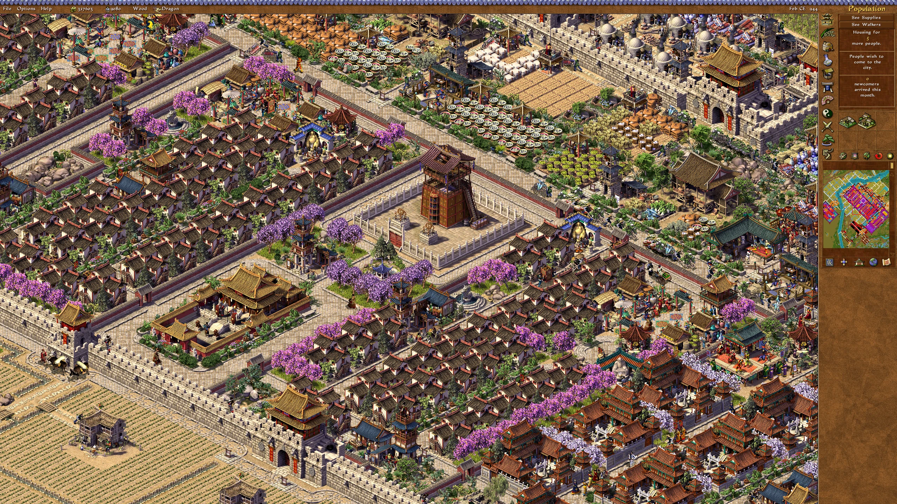
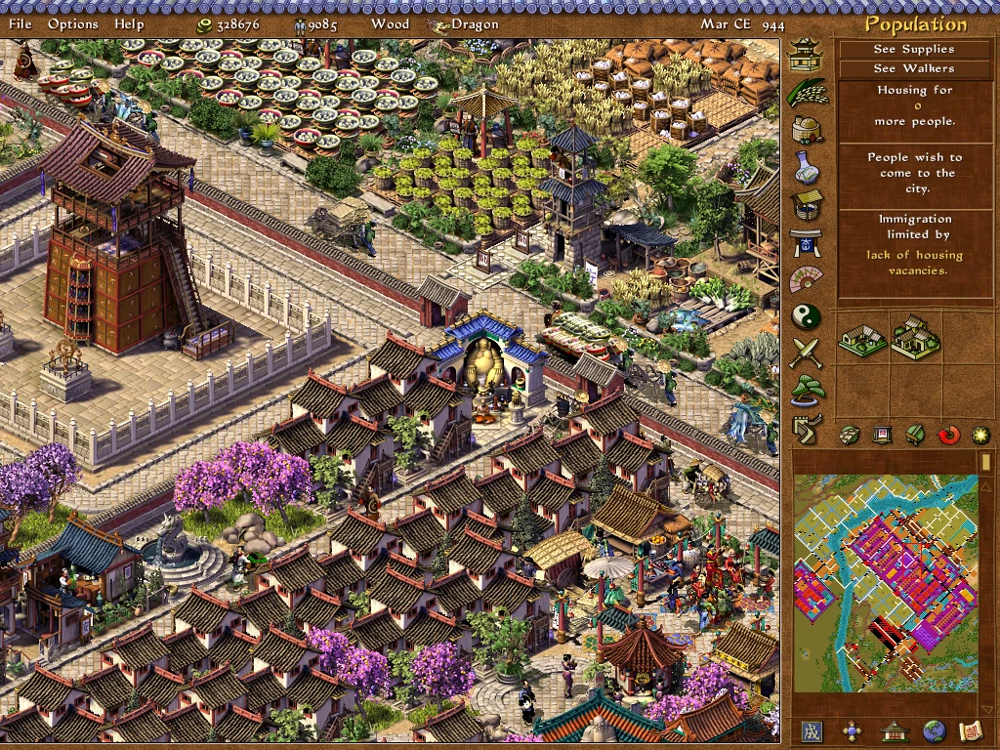

[English](../README.md) | **繁體中文** | [简体中文](README.zh-CN.md)

> 這是英文版 README 的翻譯，內容以[英文版](../README.md)為準。對應的英文版：Yongle 0.2.1。
>
> Yongle 目前不支援任何中文版的 *Emperor: Rise of the Middle Kingdom*，只能搭配英文版使用。我們正在規劃自己重新翻譯的中文化，目前還沒有確定的發布時間。

# Yongle

**為 *Emperor: Rise of the Middle Kingdom*（2002）加上現代的畫面顯示與便利性改進。**

| 平台            | 最新版本                                                                                                                                               |
| --------------- | ------------------------------------------------------------------------------------------------------------------------------------------------------ |
| Windows 10 / 11 |  |

在發布頁面下載 **`yongle-<version>.zip`**，不是「Source code (zip)」：原始碼裡沒有 `ddraw.dll`。接著看[安裝](#安裝)。

Yongle 保留原版遊戲，讓它適合現在的電腦：遊戲以你的螢幕解析度執行，介面也配合螢幕重新排列，另外加上一些便利性改進，在一個和遊戲風格相同的 Options 視窗裡設定。之後還會加入更多功能，包括遊戲玩法的選項。名稱來自明朝興建紫禁城的永樂皇帝，延續 [Julius](https://github.com/bvschaik/julius)、[Augustus](https://github.com/Keriew/augustus) 與 [Akhenaten](https://github.com/dalerank/Akhenaten) 替其他 Impressions 城市建造遊戲取名的傳統。

如果你也玩 *Zeus + Poseidon*，你可能也會喜歡姊妹專案 [Pericles](https://github.com/riap0526/pericles)：它和 Yongle 用同一套引擎、同樣的設計理念。

*使用 Yongle 的 2560×1440 城市畫面，顯示縮放 100 %。點任何一張截圖可以看原尺寸。*

對照：原版遊戲的 1024×768

## 功能與 Roadmap

每項功能的說明與截圖見 **[docs/FEATURES.md](../docs/FEATURES.md)** (English)。

接下來的 Roadmap 與之後要做的事見 **[docs/ROADMAP.md](../docs/ROADMAP.md)** (English)。

每個版本改了什麼見 **[CHANGELOG.md](../CHANGELOG.md)** (English)。

- **不切換顯示模式：** 遊戲在無邊框的全螢幕視窗裡以桌面解析度執行，銳利地放大。
- **流暢的畫面**：以螢幕的更新率顯示。遊戲本身的計時不變。
- **任何解析度：** 側欄、頂端列、城市與對話框都配合你的螢幕，顯示縮放（100–250 % 或 *Auto*）可以讓每個畫面都變大。
- **選單、載入畫面與帝國地圖**顯示在一個框裡，背景是你的城市的模糊畫面。
- **視窗模式**（F5 或 Alt+Enter）。視窗可以調整大小，大小與位置會被記住。
- **平滑捲動**城市畫面，每一種捲動速度設定都有穩定的速度。
- **城市縮放**：用滑鼠滾輪（50–150 %，地圖比較小時範圍也比較小），以游標為中心。按滑鼠中鍵回到 100 %。
- **拖曳捲動**：按住滑鼠中鍵移動。
- **Options 視窗**（F6）：遊戲的設定和 Yongle 的設定放在一起。
- **重新設定按鍵**：幾乎每個按鍵都可以改，每個動作可以設兩個按鍵。
- **Esc 關閉視窗**，在城市裡開啟**暫停選單**。
- **Difficulty 與 Auto defend** 放進 Options：遊戲本來就有這兩項，但從來不讓你改。
- **穩定的遊戲速度：** 原版在大城市、高解析度時會跑得比你設定的速度慢，現在任何解析度都照你設定的速度執行；100 % 也改成固定的速度（比 90 % 快一級），不再是電腦畫得多快就跑多快。
- **聲音：** 主音量；切換到其他視窗時，音樂與音效會暫停；環境音以穩定的頻率播放；還有遊戲裡沒有用到的自然音效。
- **截圖**（F11）、**整個城市與小地圖的截圖**（F10、Shift+F10），以及**問題回報**（F12）。

## 運作方式

Yongle 只是遊戲資料夾裡的一個 `ddraw.dll`。它用自己的 DirectDraw 取代遊戲原本用的（透過 SDL3 使用 Direct3D 11 或 9），而且只在記憶體裡修改原版的 `Emperor.exe`。遊戲的檔案和你的存檔都不會被修改。Yongle 的某個功能遇到錯誤時，會自己關掉，遊戲照原版的方式繼續執行。刪掉 `ddraw.dll`，遊戲就和以前完全一樣。長期目標是完整重新實作，不再需要 `Emperor.exe`。

**原版的美術維持原樣：** 畫面上的一切都是用遊戲自己的圖畫出來的。沒有打算使用 AI 產生或 AI 放大的背景、美術或其他圖片。

## 系統需求

- **英文版**的 *Emperor: Rise of the Middle Kingdom*，版本 1.0.1.0。開發與測試用的是 **GOG 版**（`Emperor.exe` SHA256 `6373328bfc5c4886d9abc9544eb706e89e7d465b18176ea8205fe27aaee53c0e`）。GOG 只賣英文版。其他語言的版本只在當年的零售光碟版販售：Yongle 也許可以用，但可能有問題，或部分功能沒有作用。
- 請使用沒有修改過的 `Emperor.exe`：被其他工具修改過的 exe（例如寬螢幕修正檔）可能無法使用，或造成問題。使用上面那個以外的任何 `Emperor.exe` 時，Yongle 會在啟動時於畫面上方顯示「Untested Emperor.exe」20 秒（見 [FAQ](../docs/FAQ.md#which-versions-of-emperor-does-yongle-work-with) (English)）。
- Windows 10 或 11，以及支援 Direct3D 11 的顯示卡。

## 安裝

1. 從[最新版本](https://github.com/riap0526/yongle/releases/latest)下載 `yongle-<version>.zip`（不是「Source code (zip)」）並解壓縮。`ddraw.dll` 沒有程式碼簽章，所以防毒軟體或 SmartScreen 可能會發出警告；你可以用發布頁面上的 SHA256 核對 zip。
2. 把 `ddraw.dll`、`ddraw.syms` 和 `emperor_engine.ini` 複製到遊戲資料夾（有 `Emperor.exe` 的那個資料夾）。如果資料夾裡已經有其他工具的 `ddraw.dll`（cnc-ddraw、dgVoodoo 等），先備份：同時只能使用一個。
3. 照平常的方式啟動遊戲。

**升級：** 替換 `ddraw.dll` 和 `ddraw.syms`，保留你的 `emperor_engine.ini`；Yongle 第一次啟動時會把它更新到最新。

**解除安裝：** 刪掉 `ddraw.dll`。Yongle 還會建立哪些檔案、放在哪裡（遊戲資料夾，或遊戲在 Program Files 底下時的 `Documents\My Games\Yongle`）、怎麼跳過片頭動畫、怎麼切換渲染器：見 **[FAQ](../docs/FAQ.md)** (English)。

## 按鍵

Yongle 的按鍵（預設值）：

| 按鍵            | 動作                                                                               |
| --------------- | ---------------------------------------------------------------------------------- |
| Esc             | 關閉視窗或回到上一層。在城市裡：取消建造工具，或開啟暫停選單。在主選單：離開遊戲（會先詢問） |
| F6              | 開啟／關閉 Options                                                                 |
| F5 或 Alt+Enter | 在全螢幕與視窗之間切換                                                             |
| F10             | 整個城市的截圖，存到 `shots\`                                                      |
| Shift+F10       | 小地圖的截圖，存到 `shots\`                                                        |
| F11             | 截圖，存到 `shots\`                                                                |
| F12             | 問題回報（畫面看起來不對時）                                                       |
| Insert          | 開啟／關閉除錯面板                                                                 |
| 滑鼠滾輪        | 在城市上：放大與縮小。在側欄上：切換建築類別，和原版一樣                           |
| 滑鼠中鍵        | 在城市上：按住並移動可以拖曳城市；按一下回到 100 %                                 |

遊戲本身的按鍵和原版一樣。幾乎所有遊戲的按鍵，以及上面 Yongle 的按鍵，都可以在 **Options > Hotkeys** 裡更改，每個動作還可以再設第二個按鍵。不能更改的有：遊戲的多人連線與開發者按鍵、輸入文字時用的按鍵，以及 Esc、Enter、滑鼠滾輪與滑鼠中鍵（F5 和 Alt+Enter 也不能改）。

## 設定

大部分設定在 **Options** 裡（在主選單、城市的 Options 選單裡，或按 F6），和遊戲本身的選項放在一起。**除錯面板**（Insert）有測試用的設定，以及畫面出問題時用來修正的設定。Yongle 的所有設定也都在 `emperor_engine.ini` 裡，每一項都有說明；檔案或某個設定不存在時，就用預設值。

## 已知問題

想知道 Yongle 的檔案在哪裡，或片頭動畫、渲染器的事？請先看 **[FAQ](../docs/FAQ.md)** (English)。

完整清單在 **[docs/KNOWN_ISSUES.md](../docs/KNOWN_ISSUES.md)** (English)。重點：

- 在筆電和比較慢的電腦上，**降低解析度**（調高顯示縮放，或用 *Auto*）對效能的幫助最大。
- 自己把遊戲複製到 `C:\Program Files (x86)` 底下時：Yongle 的檔案在 **`Documents\My Games\Yongle`**，不在遊戲資料夾裡。用 GOG Galaxy 安裝的遊戲會把檔案留在遊戲資料夾（見 [FAQ](../docs/FAQ.md) (English)）。
- 目前只在 AMD 顯示卡和 Intel 內建顯示晶片上測試過；NVIDIA、真正的 4K 螢幕和多螢幕還沒有測。

## 回報問題

請用 **Bug report** 表單開一個 issue。簡單來說：刪掉 Yongle 資料夾裡的 `ddraw_proxy.log`（遊戲資料夾，或 `Documents\My Games\Yongle`；見 [FAQ](../docs/FAQ.md) (English)），重現問題，看到問題的那一刻按 **F12**，然後附上新的 `ddraw_proxy.log`、`shots\report*` 的圖和你的 `emperor_engine.ini`，並寫明你做了什麼、看到什麼、你的螢幕解析度、Windows 版本和顯示卡。

## 建置與參與開發

工具、建置步驟、離線測試與程式碼的結構見 **[docs/BUILDING.md](../docs/BUILDING.md)** (English)。

怎麼提出修改，以及貢獻要遵守的規則，見 **[CONTRIBUTING.md](../CONTRIBUTING.md)** (English)。

## 致謝

- **[Augustus](https://github.com/Keriew/augustus)**（AGPL-3.0）：平滑捲動使用了它的速度漸變程式碼（`core/speed.c`，見 `third_party/augustus/`）；我們的顯示縮放、遊戲速度、設定、快捷鍵與暫停選單的設計，都以它的設計為範本。
- **[Julius](https://github.com/bvschaik/julius)**：參考了它的繪圖與計時。
- **[Akhenaten](https://github.com/dalerank/Akhenaten)**：它對 `.sg3` 圖檔格式的說明，是讀取遊戲自己的圖時的參考。
- **[OpenRCT2](https://github.com/OpenRCT2/OpenRCT2)**：從原版執行檔內部開始的做法。
- **[zeus-qol](https://github.com/andrehamon/zeus-qol)**：參考了它的 Zeus 改進的架構、地圖縮放與城市圖片匯出（沒有使用它的程式碼）。
- 函式庫：[SDL3](https://github.com/libsdl-org/SDL)（zlib）、[Dear ImGui](https://github.com/ocornut/imgui)（MIT）、[MinHook](https://github.com/TsudaKageyu/minhook)（BSD-2-Clause）、miniz（公有領域，SDL 裡附的那一份）。它們的授權在 [THIRD_PARTY_NOTICES.md](../THIRD_PARTY_NOTICES.md) (English)。
- *Emperor: Rise of the Middle Kingdom* 由 BreakAway Games 與 Impressions Games 製作，Sierra 發行。

## 免責聲明

Yongle 是非官方的愛好者專案，和 *Emperor: Rise of the Middle Kingdom* 的權利人沒有關係，也沒有得到他們的認可。你需要自己的一份遊戲；Yongle 不包含遊戲的任何檔案。

開發時使用了 AI 協助。每個階段在發布前都會實際在遊戲裡試玩。使用風險自負，並請備份你的存檔。

## 授權

Yongle 採用 **GNU Affero General Public License v3.0** 授權，見 [LICENSE](../LICENSE) (English)。第三方元件維持各自的授權，見 [THIRD_PARTY_NOTICES.md](../THIRD_PARTY_NOTICES.md) (English)。
